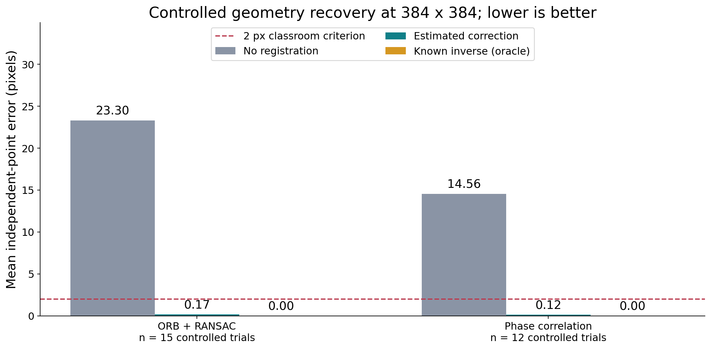
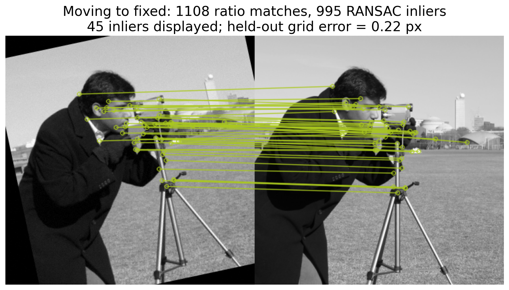
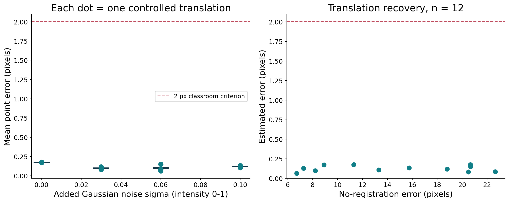
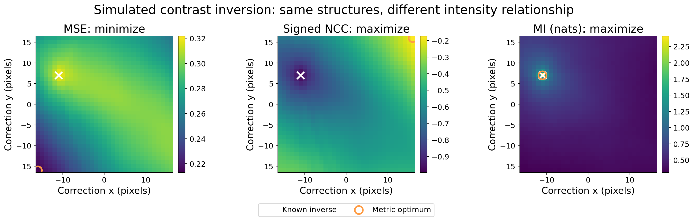
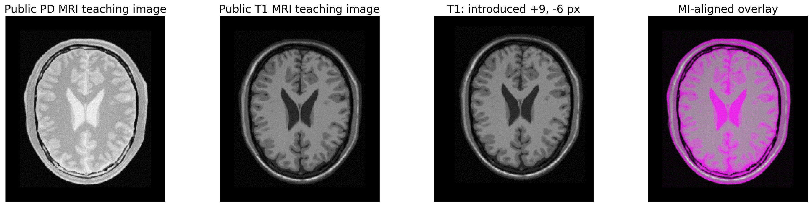
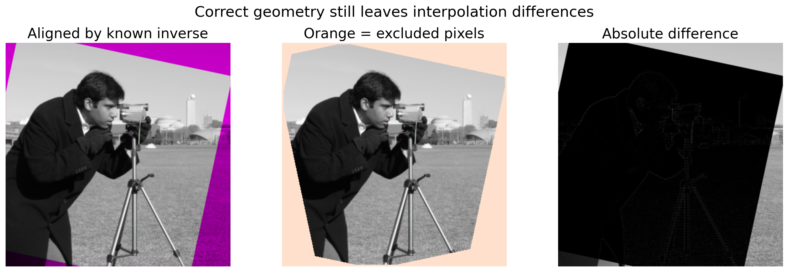

# A Practical Study of Two-Dimensional Image Registration Using Controlled Experiments

**Mark Lester O. Dampios**  
PhDCS Student, Technological Institute of the Philippines - Manila  
PHDCS103 - Image Processing  
Professor: Dr. Anna Liza Ramos  
Week 15 presentation: October 31, 2026  
Scope: Parts I–VI; chronological teaching edition; approximately 45 minutes including selected demonstrations

## Abstract

Image registration estimates a geometric relationship between images so that corresponding structures share a coordinate system. This study uses small, reproducible, CPU-based experiments to explain transformations, feature matching, intensity registration, contrast-aware similarity, and evaluation. The researcher deliberately misaligns a public image and checks estimated recovery against the known transformation. At 384 × 384 pixels, ORB with RANSAC reduced mean independent-point error from 23.304 to 0.173 pixels over 15 similarity-transform trials; phase cross-correlation reduced it from 14.558 to 0.124 pixels over 12 translation trials. Every trial mean met the predefined demonstration criterion of at most 2 pixels. A simulated contrast inversion exposes unsuitable metric assumptions, while a public T1/proton-density MRI teaching pair provides a separate contrast-pair example. Geometric recovery and photometric similarity are interpreted separately. The threshold is a classroom rule, not an industry or clinical standard. Repeated perturbations of the same source are not independent scenes or patients. The contribution is an accessible, reproducible teaching study, rather than a new registration algorithm or a clinically validated system.

**Keywords:** image registration; ORB; RANSAC; phase correlation; mutual information; geometric error; reproducible demonstration

## 1. Introduction

Two images can depict the same scene while placing corresponding objects at different coordinates. Camera movement, a change in viewpoint, acquisition at a different time, or a different imaging process can create this mismatch. Registration estimates the geometric mapping needed to establish correspondence. Image fusion subsequently combines information from the aligned images; blending before alignment can produce doubled edges or misleading combinations. The distinction between alignment and blending follows the classical registration and stitching literature [1].

The practical question in this study is straightforward: **Can the researcher recover a deliberately introduced misalignment, and what evidence supports that conclusion?** A visible improvement is helpful, but it is insufficient by itself. The experiments therefore separate the transformation model, similarity criterion, estimation procedure, and evaluation rule. They include failures so that the audience can see where an assumption stops being useful.

The study addresses four teaching questions:

1. What do translation, rotation, scale, and interpolation do to an image and its coordinates?
2. Can local features recover a known similarity transformation, and why are incorrect matches rejected?
3. When is translation-only intensity registration useful, and what happens when its motion assumption is violated?
4. Why can geometric alignment remain meaningful when corresponding pixels have different brightness values?

These questions define the scope of Parts I–VI. Deformable registration, deep learning, 3D optimization, clinical deployment, and detailed fusion algorithms are outside the experiments. The final presentation hands the discussion of fusion to the next presenter.

## 2. Background and essential mathematics

### 2.1 Fixed image, moving image, and direction

Let \(F(x)\) be the fixed image at fixed-image position \(x=(x,y)^T\), and let \(M(z)\) be the moving image at moving-image position \(z\). In this paper, \(C\) denotes a **moving-to-fixed point transform**. Thus, a corresponding moving point \(z\) should satisfy \(Cz\approx x\), using homogeneous coordinates when required.

Creating a registered raster image requires the inverse sampling map:

\[
R(x)=M(C^{-1}x).
\]

For each output pixel on the fixed grid, the program finds the corresponding location in the moving image and samples it. This avoids holes that can arise from pushing source pixels forward. Library conventions must be checked: some frameworks return a fixed-to-moving sampling transform directly [8]. The direction of a reported matrix is therefore always named, rather than inferred from its sign.

The experiments generate misalignment with a known fixed-to-moving point transform \(G\). The ideal correction is \(C_{\mathrm{true}}=G^{-1}\). A simple translation by \((+20,-10)\) pixels requires a correction of \((-20,+10)\) pixels. For a transform that includes rotation and translation, the inverse is computed as a matrix; independently negating all parameters is generally incorrect.

In the Python implementation, the variable named `A` is this paper's forward \(G\), and the variable named `M` is this paper's correction \(C\). The stored JSON labels `forward_matrix`, `inverse_matrix`, and `estimated_matrix` make their roles explicit. The slides use the same \(G,C\) notation as this paper.

Coordinates in OpenCV point arrays are \((x,y)=(\text{column},\text{row})\). A NumPy image is indexed as `[row, column]`. The shift returned by `phase_cross_correlation` follows array-axis order, \((dy,dx)\), and is the correction to apply to the moving image [6].

### 2.2 Choosing a transformation model

| Model | Expression | Parameters in 2D | Appropriate classroom interpretation |
|---|---|---:|---|
| Translation | \(x'=x+t\) | 2 | Slide an image without changing orientation or size. |
| Rigid | \(x'=R(\theta)x+t\) | 3 | Rotate and translate while preserving distances. |
| Similarity | \(x'=sR(\theta)x+t\) | 4 | Add one common scale factor; preserve angles and shape. |
| Affine | \(x'=Bx+t\) | 6 | Allow shear and unequal scale; preserve parallel lines. |
| Homography | \(\tilde x'\propto H\tilde x\) | 8 | Model a planar projective relationship; parallel lines may converge. |

Here \(R(\theta)\) is a rotation matrix, \(s\) is scale, \(t\) is translation, and a tilde denotes a homogeneous point. More flexible models can explain more motion but require stronger evidence and can fit incorrect correspondences. The researcher uses similarity registration for the feature experiment and translation for the phase-correlation experiment. Homography is introduced only to place these models in context; it is not presented as a universal model for 3D scenes [1].

### 2.3 Feature-based registration

A keypoint is a distinctive image location, such as a corner. A descriptor summarizes the neighborhood so that candidate correspondences can be found. ORB uses FAST-based detection, orientation estimation, and binary descriptions. For its default binary descriptors, Hamming distance counts differing bits [2]. Descriptor similarity identifies plausible matches; it does not establish that the points represent the same physical location.

The classroom pipeline is: detect keypoints, compute descriptors, match candidates, filter ambiguous matches, estimate a transformation robustly, and inspect the registered result. RANSAC repeatedly fits a model to small subsets and checks how many candidate pairs agree with it. It was designed to fit models in measurements containing gross errors [3]. In the implementation, OpenCV supplies the similarity estimate and inlier mask [4].

An **inlier** is a pair whose reprojection residual is below the fitting threshold. An **outlier** is inconsistent with that candidate model. The inlier ratio is

\[
\text{inlier ratio}=\frac{\text{inlier matches}}{\text{candidate matches}}.
\]

The ratio describes support for the fitted model. A high value can still accompany an incorrect result if repeated patterns produce consistent wrong matches or if the chosen model is unsuitable. Independent geometric evaluation remains necessary.

### 2.4 Intensity-based registration

Intensity methods compare image values rather than requiring explicit keypoint pairs. For valid overlapping pixel set \(\Omega\), mean squared error is

\[
\operatorname{MSE}=\frac{1}{|\Omega|}\sum_{x\in\Omega}[F(x)-R(x)]^2.
\]

Lower MSE indicates closer intensities under the same normalization and support. It is sensitive to brightness and contrast changes. The paper reports normalized image values in \([0,1]\), so the corresponding MSE scale must not be compared directly with MSE computed on 8-bit values in \([0,255]\).

Normalized cross-correlation (NCC) is

\[
\operatorname{NCC}=\frac{\sum_{x\in\Omega}(F(x)-\bar F)(R(x)-\bar R)}{\sqrt{\sum_{x\in\Omega}(F(x)-\bar F)^2\sum_{x\in\Omega}(R(x)-\bar R)^2}}.
\]

NCC lies between \(-1\) and \(+1\) when defined. Positive values near one indicate a strong positive linear intensity relationship. A contrast inversion can produce a strongly negative value even when geometry is correct. Constant images have zero variance, making the expression undefined; a software fallback value must not be interpreted as successful registration.

Phase correlation estimates translation by locating a correlation peak in the Fourier domain. A shifted image changes Fourier phase in a predictable way. Efficient local DFT refinement permits subpixel shift sampling without upsampling the whole correlation array [5]. The implementation uses scikit-image's established routine [6]. The upsampling factor sets numerical search resolution, not guaranteed accuracy. Rotation, repeated patterns, cropping, noise, or insufficient common content can undermine the translation estimate.

### 2.5 Different contrast and mutual information

Images acquired through different processes need not assign equal brightness to corresponding structures. Mutual information (MI) measures statistical dependence between paired image values:

\[
I(F;R)=\sum_{a,b}p_{FR}(a,b)\log\frac{p_{FR}(a,b)}{p_F(a)p_R(b)}.
\]

A joint histogram estimates how frequently a fixed-image intensity bin occurs with a moving-image intensity bin. When the intensities have a consistent relationship at corresponding locations, the joint distribution can be structured even when the values differ. This is the rationale for MI-based alignment [7]. Higher MI is preferred within one consistently configured search. MI is not a percentage, and its absolute value depends on the histogram bins, overlap, sampling, image content, and logarithm base.

The simulated contrast experiment changes a photograph's appearance deliberately. It is not a CT or MRI acquisition. The public ITK pair contains T1 and proton-density MRI contrasts as identified in the original example source [11]. Both belong to MRI; they differ in contrast weighting. Under a strict modality definition, CT versus MRI is intermodality registration, while T1 versus PD is intercontrast MRI registration. The teaching materials explain this distinction explicitly.

## 3. Methods

### 3.1 Experimental design

The researcher uses a controlled design with known misalignment. A single source image is transformed using recorded parameters, and the estimated correction is compared with the known inverse. The interactive laboratory permits changing one parameter at a time; the saved robustness trials combine several recorded perturbations. This design supports mechanism demonstrations; it does not estimate population-level performance on independent scenes or patients.

The public camera image is supplied by scikit-image and has an explicit CC0 dedication by photographer Lav Varshney [10]. All source images are stored locally, so presentation-time execution does not require downloading them. The public MRI example has retained ITK provenance and repository distribution attribution [11], [12]. Original patient, scanner, and acquisition metadata are not established for that teaching pair.

The experiment scripts save the random seed, transformation settings, package versions, individual trial values, and summary results. The notebook files and saved figures are generated from the same experimental implementation. Browser controls supplement the notebooks by making coordinate changes visible; the published numerical results come from the executed Python experiments.

### 3.2 Experiments and comparisons

| Experiment | Purpose | Main change | Evidence | Presentation |
|---|---|---|---|---|
| 1. Transformation laboratory | Connect coordinates to visible displacement and resampling. | Translation, rotation, scale, interpolation. | Colored landmarks, ROI, overlay, known correction. | Slides 8–10. |
| 2. Feature registration | Recover a known similarity transform and explain robust fitting. | Rotation and controlled image degradation. | Matches, inliers, independent point error, baseline and oracle. | Slides 19–30. |
| 3. Intensity registration | Recover translation under several intensity perturbations. | Translation, gain, brightness offset, noise. | Estimated shift and geometric error. | Slides 31–47. |
| 4. Contrast-aware registration | Show why equal brightness is unnecessary for correspondence. | Deliberate contrast remapping and known translation. | MSE/NCC/MI search response and geometric recovery. | Slides 48–61. |

The unregistered baseline applies no estimated correction. The oracle uses the known inverse; it is a reference for achievable geometric recovery under the constructed experiment, not a deployable estimator. Double interpolation can leave photometric residuals even for the oracle, so a nonzero oracle MSE is not evidence of incorrect inversion.

### 3.3 Recorded implementation settings

The camera image is resized from 512 × 512 to 384 × 384 using area interpolation. Its intensities are normalized to 0–1. Image generation and correction use bilinear interpolation and constant zero fill; comparison excludes introduced fill. Rotation and scale are applied about the image center. The stable base seed is **20261031**, with separate deterministic random-number streams for the feature and intensity experiments.

**Transformation laboratory.** The saved example combines \(dx=24\), \(dy=-15\) pixels, \(12^\circ\) rotation, and scale 1.03. The correction uses the exact matrix inverse. It is a deterministic coordinate and resampling demonstration, not an automatic estimation trial.

**Feature trials.** Fifteen trials draw rotation uniformly from \([-15^\circ,15^\circ]\), scale from \([0.93,1.07]\), and each translation component from \([-22,22]\) pixels. The moving image also receives gain from \([0.9,1.1]\), offset from \([-0.03,0.03]\), and Gaussian noise with standard deviation 0.01, then is clipped to 0–1. ORB retains up to 1,800 keypoints, with FAST threshold 12 and edge threshold 24. Hamming-distance two-nearest-neighbor matching is performed from moving to fixed; the best distance must be less than 0.75 times the second-best distance. `estimateAffinePartial2D` fits a similarity correction with RANSAC threshold 3 pixels, confidence 0.995, maximum 3,000 iterations, and 10 refinement iterations. The OpenCV random seed is fixed per trial. A separate uniform-image test checks whether the pipeline reports insufficient feature evidence.

**Intensity trials.** Twelve trials use translation components drawn from \([-18,18]\) pixels, gain from \([0.75,1.25]\), and offset from \([-0.06,0.06]\). Three trials are generated at each Gaussian noise standard deviation: 0, 0.03, 0.06, and 0.10. Values are clipped to 0–1. Both images are mean-centered and multiplied by a 2D Hanning window before `phase_cross_correlation`, with `normalization='phase'` and `upsample_factor=20`. The returned array-axis correction is converted to \((x,y)\) order before warping. Different translations, gains, and offsets are drawn at each noise level, so this is a set of robustness examples rather than a paired causal noise experiment.

**Contrast search.** The simulated case uses a 160 × 160 camera image and the nonlinear mapping \((1-F)^{0.65}\), followed by a known displacement of \((+11,-7)\) pixels. MSE, signed NCC, and a 32-bin histogram MI are evaluated for every integer correction in \([-16,16]^2\): 1,089 candidates per metric. All candidates use the same fixed evaluation support. The public MRI case uses the native 221 × 257 T1/PD teaching images, fixed PD foreground above 0.07, and an added T1 displacement of \((+9,-6)\) pixels. The native and perturbed pairs use the same metric and support policy; the difference between their optimal corrections measures recovery of the added displacement. No clinical ground truth is inferred.

The simulated search uses a constant central **102 × 102** ROI, containing 10,404 pixels, with a 29-pixel margin. The margin is the search radius 16 plus the largest introduced displacement component 11 plus a 2-pixel safety allowance. Thus, every candidate samples originally sourced content rather than introduced fill. The public pair uses a 27-pixel margin (16 + 9 + 2) and the same fixed-image foreground selection for native and perturbed searches, retaining **27,756** pixels. These restrictions keep both sample identity and sample count constant during metric comparison. Original background already present in a source image is distinct from fill introduced by the researcher's warp.

The recorded run uses Python 3.12.7 on Windows 11, NumPy 1.26.4, SciPy 1.13.1, OpenCV 4.11.0, scikit-image 0.24.0, and Matplotlib 3.9.2. OpenCV uses one thread. Timings include the registration operation only, excluding loading and plotting, and are hardware-specific. Exact versions and image SHA-256 hashes are retained in [manifest.json](../experiments/results/manifest.json).

### 3.4 Evaluation and acceptance rule

Let \(p_i\) be an evaluation point on the fixed grid, and \(Gp_i\) its known moving-image position. For estimated moving-to-fixed transform \(\hat C\), point error is

\[
e_i=\|\hat C Gp_i-p_i\|_2,
\qquad
\bar e=\frac{1}{N}\sum_{i=1}^Ne_i.
\]

Errors are in pixels at the evaluated image resolution. Evaluation points are independent of the feature correspondences used for fitting. They are geometric probes generated from the known transform, not manually identified anatomical landmarks. Mean error summarizes recovery; maximum error reveals whether some tested locations are substantially worse. Zero is the exact geometric ideal.

The researcher selects **mean point error \(\leq2\) pixels** as the demonstration success criterion for these experiments. The criterion is declared before interpreting the resulting values and is not taken from an industry standard. It is easy to explain at classroom display resolution. A 1.9-pixel mean meets this particular rule; a 2.1-pixel mean does not. Neither number, by itself, establishes suitability for a real application. Resizing an image changes the physical meaning of one pixel.

Photometric metrics are computed only over valid overlap, with a common comparison support where needed. Empty regions introduced by warping do not represent measured scene content and must not improve a score by being compared with black padding. The retained overlap fraction accompanies interpretation. Similarity, matching residuals, and visual overlays are supporting indicators. Published work demonstrates that image similarity and tissue overlap can be misleading surrogates for registration accuracy [9]; this study therefore uses the known geometric relationship as the primary evidence.

For the public MRI pair, a reported displacement-recovery error concerns the added known perturbation relative to the supplied pair. The original anatomical correspondence is not independently established. Therefore, the result is not a clinical target registration error, and pixels are not converted to millimeters without reliable physical metadata.

## 4. Results

### 4.1 Geometric recovery

| Experiment | Resolution | Controlled cases | Mean error without correction (px) | Mean error after correction (px) | Largest trial mean (px) | Trials meeting \(\leq2\) px |
|---|---|---:|---:|---:|---:|---:|
| ORB + RANSAC similarity | 384 × 384 | 15 | 23.304 | 0.173 | 0.375 | 15/15 |
| Windowed phase cross-correlation translation | 384 × 384 | 12 | 14.558 | 0.124 | 0.176 | 12/12 |

Each trial mean averages Euclidean errors over an independent 8 × 8 grid spanning the central 70% of the fixed image, retaining only points whose forward locations remain inside the moving image. These points never enter estimation. The table reports the mean of trial means; “largest trial mean” is not the largest individual point error. The known inverse has zero geometric error by construction, up to floating-point roundoff.

The feature result supports recovery of the tested modest similarity transforms on one textured source. The phase result supports recovery of the tested translations under the recorded gain, offset, and noise combinations. Since the two experiments use different motion families and random settings, their average errors are not an overall algorithm ranking.

**Figure 1.** Mean independent-point error in pixels; lower is better. Gray bars show no correction, teal bars show the estimate, and the known-inverse reference is zero. The dashed line is the 2-pixel demonstration criterion. Sample counts are 15 and 12 controlled perturbations of the same photograph, respectively.

### 4.2 Feature evidence and a measured failure

In the saved feature example, ORB detected 1,766 fixed-image and 1,767 moving-image keypoints. A total of 1,108 matches passed the ratio filter; 995 were RANSAC inliers, an inlier ratio of 89.8%. The independent grid had 64 points, with mean error **0.217 pixels** and maximum point error **0.431 pixels**. The match figure displays only 45 inliers for readability.

On the common support of 119,757 pixels, MSE fell from **0.047963** to **0.000491**, while NCC increased from **0.7273** to **0.9976**. The oracle MSE was **0.000405** and NCC **0.9981**. These photometric values support closer appearance under this particular same-source experiment. The independent point error is the direct evidence for the constructed geometry. Common support represented 81.2% of the 384 × 384 grid.

The separate uniform-image test produced **zero keypoints in both images**, zero matches, and no estimated transform. It is retained as a measured negative: without distinctive local neighborhoods, the feature pipeline has insufficient evidence.

**Figure 2.** Moving-to-fixed correspondence display. Forty-five inliers are drawn from the saved example. Inlier support is a fitting diagnostic; it is not an independent accuracy percentage.

### 4.3 Intensity and noise examples

| Added Gaussian noise standard deviation (0–1 scale) | Trials | Mean geometric error (px) | Range of trial means (px) |
|---:|---:|---:|---:|
| 0.00 | 3 | 0.175 | 0.172–0.176 |
| 0.03 | 3 | 0.099 | 0.081–0.117 |
| 0.06 | 3 | 0.100 | 0.064–0.150 |
| 0.10 | 3 | 0.123 | 0.107–0.134 |

Every trial met the demonstration criterion. The variation is not monotonic in noise level. Because the shifts, gains, and offsets also differ between trials, this table does not isolate noise as a cause and does not show that noise improves estimation.

The saved intensity example introduced a displacement of approximately **(+16.793, −15.213) pixels**. Phase correlation estimated a correction of approximately **(−16.850, +15.150) pixels**, leaving **0.085 pixels** of mean geometric error. This example makes the distinction between introduced displacement and recovered correction explicit.

**Figure 3.** Left: each dot is one trial; noise standard deviation is on the horizontal axis, geometric error in pixels on the vertical axis, and the horizontal mark is the three-trial mean. Right: the unregistered and estimated errors are compared per trial. These are controlled same-source trials, not independent scenes.

### 4.4 Contrast-aware matching

The simulated case has known correction **(−11, +7) pixels**, with no-correction error **13.038 pixels**. The selected corrections and errors are:

| Criterion and direction | Best correction within tested window (dx, dy), px | Score at that candidate | Geometric error (px) | Meets demonstration criterion? |
|---|---|---:|---:|---|
| MSE, minimize | (−16, −16) | 0.213068 | 23.537 | No |
| Signed NCC, maximize | (+16, +16) | −0.172588 | 28.460 | No |
| MI, maximize | (−11, +7) | 2.412159 nats | 0.000 | Yes |

All three searches use identical 10,404-pixel support and 1,089 candidate corrections. MSE and signed NCC select search-window boundaries that are geometrically worse than leaving the pair uncorrected. MI selects the known inverse in this constructed example. The table does not compare metric magnitudes across columns as though they had a common unit. Maximizing absolute NCC would be a different objective that can handle this special contrast-inversion relationship; its behavior is not tested here.

**Figure 4.** Each heatmap's horizontal and vertical axes are correction components in pixels. The known inverse and the metric-selected candidate are marked separately. Each color scale uses that panel's metric. The experiment illustrates one simulated contrast relationship, not universal MI superiority.

For the public T1/PD MRI teaching pair, the added displacement is **(+9, −6) pixels**. The native metric optimum is **(0, 0)** for MSE, NCC, and MI. After the displacement, all three select **(−9, +6)**. Thus, each recovers the introduced increment with **0 pixels** of perturbation-recovery error. The initial added-displacement magnitude is **10.817 pixels**.

This public example is deliberately reported even though MI does not uniquely outperform the other criteria. Different contrast does not automatically invalidate MSE or positive correlation. Here, all three criteria retain enough useful correspondence to recover the added translation within the tested window. The zero incremental error does not certify that the source pair is anatomically exact or suitable for a medical decision.

**Figure 5.** Fixed proton-density image, supplied T1 image, deliberately displaced T1 image, and the MI-aligned overlay. The 221 × 257 images are a public ITK teaching pair. The measured ground truth concerns the added displacement relative to each metric's native optimum; acquisition-level anatomical truth remains unverified.

### 4.5 Resampling despite correct coordinates

In the transformation laboratory, applying the known inverse reduced geometric error from **35.397 pixels** to approximately zero. Nevertheless, MSE remained **0.000278** on the common valid support of 114,611 pixels, or 77.7% of the image. This is expected: the raster has been interpolated during image generation and correction. The correct coordinate mapping does not imply perfect recovery of every original intensity.

**Figure 6.** The excluded region is marked in orange. The difference image shows interpolation residuals despite correct geometry. Introduced empty borders are not treated as observed scene content in the similarity comparison.

Median registration-only times in the saved notebook run were approximately **0.212 seconds** for the feature pipeline and **0.021 seconds** for the phase estimator. The feature and phase tasks differ, concurrent machine load can affect timing, and these observations are not hardware-independent speed benchmarks. Trial-level timing remains available in the CSV files.

## 5. Discussion

### 5.1 What makes the result useful?

The aim is to demonstrate why a method succeeds under a stated assumption and why it can fail when that assumption is violated. A method that recovers small translations accurately is useful evidence for translation-only data. It is not evidence that the same method will handle rotation or deformation. Likewise, recovering a constructed similarity transform with ORB does not establish that feature matching works equally well on every medical or satellite image.

Feature fitting and intensity registration answer different questions. ORB supplies explicit local correspondences and can estimate rotation, scale, and translation when enough distinctive neighborhoods survive. Phase correlation efficiently estimates translation using image-wide information. A comparison across their different task settings explains method selection; it is not an overall ranking of algorithms.

The most important comparisons are within a controlled question: unregistered versus estimated alignment, ordinary fitting versus robust fitting under the same outlier contamination when available, and estimated alignment versus the known inverse. The oracle distinguishes estimator error from unavoidable interpolation effects. Independent test points distinguish model recovery from the residual on points already used to fit the model.

### 5.2 How should numbers be judged?

| Quantity | Unit or range | Preferred direction | What it can establish | What it cannot establish alone |
|---|---|---|---|---|
| Independent mean point error | Pixels; minimum 0 | Lower | Recovery of the known constructed transform at tested locations. | Clinical or application safety. |
| Maximum point error | Pixels; minimum 0 | Lower | Worst tested location. | Worst error everywhere in the image. |
| Inlier count / ratio | Count / fraction | Context dependent | Amount of support for the fitted model. | Correct physical correspondence. |
| MSE | Squared normalized intensity | Lower for comparable brightness | Photometric agreement over stated support. | Geometry across different contrast. |
| NCC | \([-1,1]\) if defined | Near +1 for positive linear contrast | Linear intensity agreement. | Geometric correctness in all modalities. |
| MI | Nats for natural logarithm | Higher within a fixed setup | Statistical dependence of paired intensities. | Universal registration quality or a percentage score. |
| Runtime | Seconds on the recorded machine | Lower for a given task | Observed computation cost. | Hardware-independent speed. |

There is no universal number that can be applied meaningfully to all these quantities and all applications. A deployment decision requires task-specific tolerances, image resolution or ground sampling distance, uncertainty, and validation on representative data. For medicine, important targets and physical distances matter; for remote sensing, ground sampling distance and the downstream mapping task matter. This follows from the units and task definition, rather than from claiming that the study searched every professional standard.

### 5.3 Meaningful negative outcomes

A failure is informative when the experimental question is explicit. If a translation method returns a low-confidence or incorrect shift after rotation is introduced, the result illustrates model mismatch. If texture is removed and ORB finds too few correspondences, that outcome illustrates insufficient local evidence. If contrast inversion leaves MSE high despite correct geometry, the outcome illustrates the distinction between appearance and position. Such conditions are retained rather than omitted to make a method appear universally successful.

### 5.4 Relation to remote sensing, medicine, and fusion

In remote sensing, registration can align overlapping views or imagery from different dates before change analysis or combining sensor information. Real scenes may add terrain relief, cloud cover, seasonal change, or sensor geometry beyond these 2D examples. In medicine, registration can establish spatial correspondence between scans or MRI contrasts, but anatomy, distortion, motion, and physical coordinates require substantially more validation than the present teaching experiment. These are application motivations; no experiment here evaluates diagnostic decisions or clinical outcomes.

Registration estimates where information corresponds. Fusion decides how to combine that information. A simple overlay is useful to inspect alignment, but it is not evaluated here as an optimal image-fusion technique. This distinction provides the handoff to the next presentation.

## 6. Limitations and reproducibility

The study is limited to 2D classical methods and CPU execution. Repeated controlled transformations of one photograph are repeated trials on one source image, not independent scenes. Repeated MRI perturbations are not additional patients. The controlled transform belongs to the tested model family, which makes this an approachable but favorable test. Search bounds, histogram bins, preprocessing, and interpolation can influence results. No claim of algorithmic novelty, statistical population superiority, or clinical readiness is made.

Ground truth is exact only for the transformations introduced by the researcher. Real acquisition errors already present in the source images remain unknown. The MRI teaching pair lacks separately verified anatomical landmarks and original acquisition metadata. Its role is to illustrate contrast-aware matching, not to establish a medical benchmark.

The recorded environment is CPU-based, and runtime depends on the machine and current load. The reproducible unit is the saved source, settings, code, and output together. Notebooks show the same tables and figures as the slides and can be run sequentially. The offline browser laboratory can be used when interactive notebook controls are inconvenient; saved figures provide a fallback during the presentation.

### 6.1 Reproduction files

- [Experiment implementation](../experiments/scripts/registration_lab.py)
- [Executed chronological notebook and evidence](../notebooks/)
- [Recorded numerical results](../experiments/results/summary.json) and [results directory](../experiments/results/)
- [Input provenance, licenses, source commit, and checksums](../experiments/data/PROVENANCE.md)
- [Saved figures](../experiments/figures/)
- [Offline interactive laboratory](../demo/)
- [Environment requirements](../requirements.txt)
- [Source verification notes](../docs/source_verification_notes.md) and [numbered reference data](../content/references.json)
- [Measurements guide](../MEASUREMENTS_GUIDE.md)
- [Project instructions and execution guide](../README.md)

### 6.2 Alignment with Parts I–VI and slides

| Part | Scope | Slides | Paper section |
|---|---|---|---|
| I | Picture values and addresses, movement, resampling, point measurement and least-squares fitting. | 3–18 | 2.1–2.2; Experiment 1; R1. |
| II | Distinctive places, ORB descriptors, matching, residuals, thresholds and RANSAC. | 19–30 | 2.3; Experiment 2; R2. |
| III | MSE, RMSE, signed NCC, graph reading, sampling offsets and subpixel translation. | 31–47 | 2.4; Experiment 3; R3. |
| IV | Same/inverted/nonlinear shade rules, MI and the public MRI contrast pair. | 48–61 | 2.5; Experiment 4; R4. |
| V | Weak evidence, valid common content, workflow, entropy, NMI and crop sensitivity. | 62–70 | 5.1–5.4; R5. |
| VI | Independent position checks, baselines, limits and interpretation. | 71–82 | 3.4; 4; 5.2; 6; R6. |

These numbers refer to the explained chronological deck. Slides 1–2 introduce the lesson. Slide 82 hands off to fusion, and slides 83–86 list references. 44 main slides provide approximately forty-two minutes of planned discussion and selected demonstrations, with three minutes for switching and pauses. The other 42 slides are optional details and references, hidden during normal PowerPoint playback. Explain one worked example once, then change one value in its demonstration. The longer notes are preparation material. Covering every optional lesson requires additional time.

The [single offline demonstration](../demo/index.html), [executed chronological notebook](../notebooks/01_chronological_experiments.ipynb), [presenter script](../presentation/PRESENTER_SCRIPT.md) and [exact slide map](../content/SLIDE_DEMO_MAP.md) use this chronological numbering. Original experiment settings and measured results remain unchanged. Historical source-slide identifiers are provenance only; the current slide map supplies the presentation numbering used here.

## 6.3 Related research and bounded reproductions

The researcher connects each assigned topic to a published study and executes a bounded CPU experiment. The six new cases supplement the earlier experiment families. Their settings differ, so the researcher does not combine them into a head-to-head algorithm ranking. The controlled changes provide known answers for evaluation. They do not recreate the original papers’ full benchmarks.

| Part / case | Published study | Reproduction level | Tested question |
|---|---|---|---|
| I / R1 | [13] 1991 | bounded library method reimplementation | With the same coordinate-noise draws, does fitting widely spread points or tightly clustered points give the smaller error at independent points? |
| II / R2 | [14] 2011 | bounded pipeline adaptation | How do rotation and blur change usable match support and independent geometric error in this particular ORB-plus-RANSAC pipeline? |
| III / R3 | [5] 2008 | bounded library method reimplementation | Does increasing the upsampling factor always reduce the measured translation error? |
| IV / R4 | [7] 1997 | bounded metric adaptation | Which tested contrast changes preserve enough statistical dependence for the bounded MI search to select the known correction? |
| V / R5 | [15] 1999 | bounded 2d metric adaptation | As crop width shrinks, do MI and NMI still score the known 8-pixel sampling offset above the two tested wrong offsets? |
| VI / R6 | [9] 2012 | concept illustration | Can an excellent similarity score coexist with a clearly incorrect geometric displacement on a repeated pattern? |

### R1. Least-Squares Estimation of Transformation Parameters Between Two Point Patterns

For paired point patterns and the stated rank conditions, a closed-form singular-value-decomposition solution minimizes squared correspondence error while enforcing a proper rotation rather than a reflection. [13].

The researcher’s reproduction: Use 16 known 2D correspondences under one known similarity transform. Compare spatially spread versus tightly clustered fitting layouts at localization-noise sigma 0, 0.5, and 2 pixels, reusing fixed normal draws. Fit the SVD solution and check 25 separate points. Also retain a coincident-point degeneracy failure.

Recorded result: At the same sigma, fitting residuals are almost identical but clustered correspondences extrapolate poorly.

Scope of the published evidence: The theorem operates on given paired point patterns and states rank conditions for uniqueness. It solves the least-squares objective; it does not assert robust recovery of the true transform from arbitrary incorrect correspondences.

Classroom follow-up: Measure how localization noise and the spatial spread of fitting points affect independent geometric recovery. This conditioning question is the researcher's classroom extension, not an unresolved problem claimed by Umeyama. Incorrect correspondences are not tested in this run.

Limits of the new experiment: New 2-D points, one draw, no wrong matches; no robustness or original numerical benchmark replication.

### R2. ORB: An efficient alternative to SIFT or SURF

ORB combines oriented FAST keypoints with a rotated, learned binary descriptor to obtain an efficient feature method; the original paper evaluates its matching behavior on its own experiments. [14].

The researcher’s reproduction: Run actual Python/OpenCV ORB and RANSAC on a 256 x 256 public photograph under four rotations (0, 15, 45, 75 degrees) and three moving-image blur settings (sigma 0, 1.5, 3 pixels). Replay saved real descriptors, matches, and fitted transforms in the browser. Fit in the forward fixed-to-moving direction and separately evaluate an inverse independent-point check.

Recorded result: Strong blur reduced match counts and increased independent geometric error in these measured conditions.

Scope of the published evidence: The specific phone-tracking application in Section 6.3 assumes a planar surface with sufficient texture. This is an application assumption, not a statement that every ORB use is planar. The original comparative timings describe its own implementation and hardware.

Classroom follow-up: Vary controlled rotation and blur, then compare support counts with independent geometric error. Blur sensitivity under these settings is a classroom extension; the researcher does not claim it is a new unresolved gap or a quoted conclusion of the ORB paper.

Limits of the new experiment: One public photo; synthetic movement; no detector benchmark, real camera acquisition or timing comparison. Returned inlier masks precede final refinement.

### R3. Efficient subpixel image registration algorithms

The paper develops efficient 2D translation-registration algorithms, including local matrix-multiply DFT refinement, with accuracy comparable to conventional FFT upsampling at lower computation and memory cost in the reported experiments. [5].

The researcher’s reproduction: Use a periodic Fourier-generated fractional translation, upsampling factors 1, 10, and 100, and the public scikit-image implementation with normalization=None. Compare clean, noisy, occluded, and extra-rotation cases. In the rotation-violating case, the reported scalar checks the translation component only; it is not a measure of complete geometric recovery.

Recorded result: The clean decimal shift is exactly represented on a 0.1 px grid; the rotated condition remains wrong on a 0.01 px grid.

Scope of the published evidence: The problem is translation registration; p. 157 explicitly identifies noise as an eventual accuracy limit. The paper discusses phase correlation and windowing as extensions, so an implementation using those settings must be labeled accordingly.

Classroom follow-up: Separate upsampling factor from measured displacement error and show whether gains plateau under the controlled image-generation process.

Limits of the new experiment: Periodic boundary; one image and noise draw. Rotated-case error measures the translation component, not full geometric alignment.

### R4. Alignment by Maximization of Mutual Information

Alignment can be formulated by maximizing statistical dependence between model and image intensities; the paper uses nonparametric density estimation and stochastic optimization and reports MRI and vision experiments. [7].

The researcher’s reproduction: Use a 96 x 96 public photograph, a known (+6, -4)-pixel forward displacement, and three explicitly simulated intensity rules: v, 1-v, and 1-v^0.7. Compare MSE, signed NCC, and 32-bin histogram MI at all 441 integer sampling offsets in [-10,10]^2 on the same 3,136 source-valid fixed pixels. Convert the selected sampling offset to the opposite-sign point correction.

Recorded result: MI recovered the known integer shift in all three appearances. Signed NCC and MSE chose wrong shifts after inversion.

Scope of the published evidence: The paper's single-view model can fail when the aligned model and image lack a consistent relationship; it then develops a multiview construction. Its local optimization also requires an initialization and has a finite capture range in the reported examples.

Classroom follow-up: Test several clearly labeled intensity mappings and inspect both the metric optimum and independent geometry; do not assume that MI succeeds for every transformation or image relationship.

Limits of the new experiment: Teaching adaptation, not Viola/Wells Parzen estimation or optimizer; simulated contrasts are not acquired modalities; bounded translation only.

### R5. An overlap invariant entropy measure of 3D medical image alignment

The paper introduces normalized mutual information to reduce sensitivity to changing image overlap in the registration setting it studies. Its title is not a guarantee that every empirical histogram, crop, or image pair will be invariant. [15].

The researcher’s reproduction: Use a 128-pixel public photograph with a known horizontal sampling offset of 8 pixels. Evaluate only three offsets (0, 8, and 16 pixels) at six crop widths (96, 72, 48, 24, 12, and 6 pixels), using real source content and a 32-bin histogram. Record the sample count and MI/NMI at each crop. This is a three-candidate comparison, not a full registration search.

Recorded result: Exact aligned equal values keep NMI=2 here while MI changes with crop content; wrong alignments also change. No universal advantage follows.

Scope of the published evidence: The later primary analysis by Cahill et al. supplies a counterexample to universal overlap invariance of ordinary NMI. Its modified measures obtain invariance only under stated background-statistics assumptions. This is a published follow-up finding, not a quotation attributed to the 1999 authors.

Classroom follow-up: Ask how crop width changes the correct-versus-wrong candidate score ordering; allow MI and NMI to tie or behave similarly. Cropping changes scene composition and sample count together, so the experiment does not isolate sample count alone.

Limits of the new experiment: A perfect same-contrast relation is an easy special case, not a 3-D multimodal replication or proof of overlap invariance. Crop size and content change together.

### R6. Image Similarity and Tissue Overlaps as Surrogates for Image Registration Accuracy: Widely Used but Unreliable

The paper constructs highly inaccurate nonrigid mappings that perform well on widely used similarity and tissue-overlap surrogates, demonstrating that such scores alone can mislead evaluation. [9].

The researcher’s reproduction: Use periodic binary stripes with period 8 pixels and a known 5-pixel horizontal sampling offset. Compare the correct offset +5 with wrong lookalikes +13 and -3: their intensity arrays match, but independent point positions differ by one period. Periodic wrap is explicit.

Recorded result: Offsets +5, +13 and -3 have identical perfect similarity, but the latter two each miss known physical positions by 8 px.

Scope of the published evidence: Section IV.B explicitly limits CURT to same-modality registration and explains that tests with known deformations do not establish registration accuracy between independent acquired images. Section IV.C calls for independent spatial evidence. The class periodic-pattern example uses a different mechanism from CURT.

Classroom follow-up: Provide independent points with a known displacement so the audience can see the conflict between geometric truth and an ambiguous appearance score.

Limits of the new experiment: Constructed 2-D counterexample illustrating Rohlfing's warning, not a reproduction of the 3-D clinical experiment or a universal frequency of failure.

The term gap refers here to an evidenced limitation or a testable extension. The researcher does not infer current novelty solely from the age or scope of one paper. In particular, the later overlap-invariance analysis [16] qualifies broad claims about normalized mutual information. The full source locations and adaptation differences accompany the research records.

The additional reproducibility files are `research/scripts/reproduce_studies.py`, `research/results/study_results.json`, the raw per-case CSV files, and `research/notebooks/01_six_research_connections.ipynb`. The browser labels each operation as a live calculation or a replay of an executed Python condition.

## 7. Conclusion

Image registration is most understandable when the geometric question, image relationship, and evaluation rule are stated before running an algorithm. The controlled experiments connect visible alignment with known transformations and independent point error. Feature matching, phase correlation, and mutual information are presented as tools with different assumptions. The main practical lesson is to choose a model and similarity measure appropriate to the image pair, inspect valid overlap and failure cases, and judge the recovered geometry using evidence appropriate to the intended task. Registration then provides the spatial foundation for image fusion.

## References

[1] R. Szeliski, *Image Alignment and Stitching: A Tutorial*, Microsoft Research Technical Report MSR-TR-2004-92, 2004. [Institutional publication record](https://www.microsoft.com/en-us/research/publication/image-alignment-and-stitching-a-tutorial/).

[2] OpenCV contributors, “ORB (Oriented FAST and Rotated BRIEF),” *OpenCV 4.13.0 Documentation*, accessed October 15, 2026. [Official documentation](https://docs.opencv.org/4.13.0/d1/d89/tutorial_py_orb.html). Original algorithm: E. Rublee, V. Rabaud, K. Konolige, and G. Bradski, “ORB: An efficient alternative to SIFT or SURF,” *ICCV*, pp. 2564–2571, 2011, doi:10.1109/ICCV.2011.6126544.

[3] M. A. Fischler and R. C. Bolles, “Random Sample Consensus: A Paradigm for Model Fitting with Applications to Image Analysis and Automated Cartography,” *Communications of the ACM*, vol. 24, no. 6, pp. 381–395, 1981, doi:10.1145/358669.358692. [Original institution record](https://www.sri.com/publication/artificial-intelligence-pubs/random-sample-consensus-a-paradigm-for-model-fitting-with-applications-to-image-analysis-and-automated-cartography/).

[4] OpenCV contributors, “Camera Calibration and 3D Reconstruction: estimateAffinePartial2D,” *OpenCV 4.13.0 Documentation*, accessed October 15, 2026. [Official API reference](https://docs.opencv.org/4.13.0/d9/d0c/group__calib3d.html).

[5] M. Guizar-Sicairos, S. T. Thurman, and J. R. Fienup, “Efficient subpixel image registration algorithms,” *Optics Letters*, vol. 33, no. 2, pp. 156–158, 2008. [doi:10.1364/OL.33.000156](https://doi.org/10.1364/OL.33.000156).

[6] scikit-image contributors, “skimage.registration: phase_cross_correlation,” *scikit-image Documentation*, accessed October 15, 2026. [Official API reference](https://scikit-image.org/docs/stable/api/skimage.registration.html).

[7] P. Viola and W. M. Wells III, “Alignment by Maximization of Mutual Information,” *International Journal of Computer Vision*, vol. 24, no. 2, pp. 137–154, 1997. [doi:10.1023/A:1007958904918](https://doi.org/10.1023/A:1007958904918).

[8] SimpleITK contributors, “Registration Overview,” *SimpleITK Documentation*, accessed October 15, 2026. [Official registration overview](https://simpleitk.readthedocs.io/en/latest/registrationOverview.html).

[9] T. Rohlfing, “Image Similarity and Tissue Overlaps as Surrogates for Image Registration Accuracy: Widely Used but Unreliable,” *IEEE Transactions on Medical Imaging*, vol. 31, no. 2, pp. 153–163, 2012, doi:10.1109/TMI.2011.2163944. [Full research article](https://pmc.ncbi.nlm.nih.gov/articles/PMC3274625/).

[10] scikit-image contributors, “skimage.data.camera,” image by Lav Varshney, CC0, accessed October 15, 2026. [Official image provenance](https://scikit-image.org/docs/stable/api/skimage.data#skimage.data.camera).

[11] Insight Software Consortium / ITK contributors, “ITK ImageRegistration2.cxx: T1 and proton-density MRI registration example,” accessed October 15, 2026. [Original example source](https://raw.githubusercontent.com/InsightSoftwareConsortium/ITK/main/Examples/RegistrationITKv4/ImageRegistration2.cxx).

[12] Insight Software Consortium / NumFOCUS, “ITK LICENSE,” Apache License 2.0, accessed October 15, 2026. [Repository license](https://raw.githubusercontent.com/InsightSoftwareConsortium/ITK/main/LICENSE).

[13] Shinji Umeyama. Least-Squares Estimation of Transformation Parameters Between Two Point Patterns. IEEE Transactions on Pattern Analysis and Machine Intelligence, 1991. [Primary source](https://doi.org/10.1109/34.88573).

[14] Ethan Rublee, Vincent Rabaud, Kurt Konolige, Gary Bradski. ORB: An efficient alternative to SIFT or SURF. 2011 International Conference on Computer Vision, 2011. [Primary source](https://doi.org/10.1109/ICCV.2011.6126544).

[15] Colin Studholme, Derek L. G. Hill, David J. Hawkes. An overlap invariant entropy measure of 3D medical image alignment. Pattern Recognition, 1999. [Primary source](https://doi.org/10.1016/S0031-3203(98)00091-0).

[16] Nathan D. Cahill, Julia A. Schnabel, J. Alison Noble, David J. Hawkes. Revisiting overlap invariance in medical image alignment. 2008 IEEE Computer Society Conference on Computer Vision and Pattern Recognition Workshops, 2008. [Primary source](https://doi.org/10.1109/CVPRW.2008.4562989).

## Worked measurement explanations in the teaching edition

The researcher separates brightness scores from geometric checking distances. [The measurements guide](../MEASUREMENTS_GUIDE.md) and [executed notebook](../notebooks/01_chronological_experiments.ipynb) show the individual operands and calculation steps.

| Explanation | Worked calculation | Slides | Evidence type |
|---|---|---|---|
| Translation-component error | Known correction (y,x)=(-5.4,+3.7), returned (-5,+4). The component gaps 0.4 and 0.3 give sqrt(0.4²+0.3²)=0.5 px. A remaining turn is outside this ruler. | 46 | Actual saved R3 clean whole-pixel result. |
| MI | Two observed pair types each have fraction0.5, versus no-clue product0.25. Add two terms0.5ln(2) to obtain ln(2), about0.693147 nats. | 54–55 | Explicit four-pair teaching construction. |
| Known-offset error | Known sampling (x,y)=(6,-4), chosen(10,10). Gaps4 and14 give sqrt(212), about14.5602 px. | 58 | Actual saved R4 inverted-MSE choice. |
| Public MRI achievement | An added(+9,-6) move is undone by(-9,+6), reducing added-movement error from about10.816654 to0 px for all three methods. Brightness MSE remains about0.127777 after correction because the MRI contrasts differ. | 60–61 | Actual public-pair experiment; original anatomical truth untested. |
| NMI | Use(Hfirst+Hsecond)/Hjoint. The useful two-label rule gives2, independent pairings give1, and both constant images give undefined0/0. | 67–68 | Same teaching counts and chosen Studholme formula. |
| Independent point error | One supplied inverse scale0.55 returns doubled x positions20,40,60 to11,22,33 instead of10,20,30. Distances1,2,3 have mean2 fixed pixels. | 16, 73 | Supplied arithmetic example, not an invented estimated algorithm result. |

Every number needs its quantity, unit, baseline and purpose. Neither MI nor NMI is an accuracy percentage. The MRI check establishes recovery of a known added movement relative to each method's native optimum, not a clinical alignment claim. The independent toy illustrates mean position distance; the recorded R1 and R2 evidence retains its own check-point coordinates and measured results.
